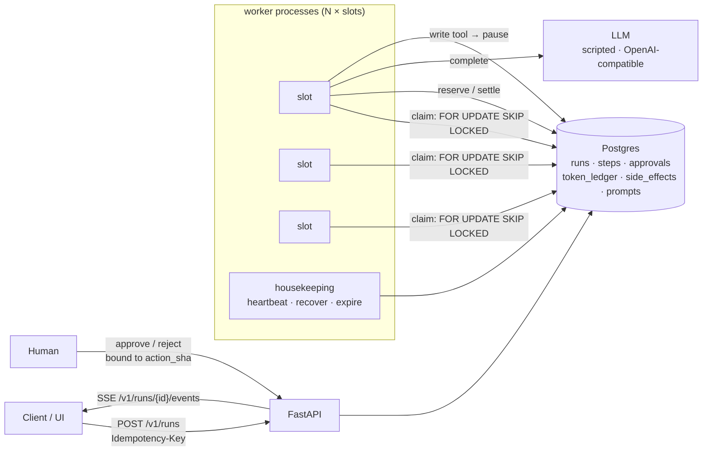

<div align="center">

# runloop · durable-agent-runtime

**Agents that survive crashes, respect token budgets, and ask a human before they write.**
Postgres queue (`SKIP LOCKED`) · resumable transcripts · exactly-once side effects · approval inbox.


**English** · [Português](README.pt-BR.md)


</div>

---

## The problem

A demo agent is a `while` loop in one process. A production agent is a
long-lived job that **will** meet a deploy, an OOM kill, a provider 429, a
human who takes three hours to approve, and a user who clicks "submit" twice.
This repository is the runtime that makes those boring.

> Model-agnostic: `LLM_PROVIDER=openai` points the agent at any OpenAI-compatible
> endpoint (OpenAI, OpenRouter, vLLM, Ollama), with the key read from the environment,
> never the repo. Behind the same interface, a deterministic reference planner makes
> every test, demo and chaos drill exactly reproducible.

## Guarantees, and how they are tested

| Guarantee | Mechanism | Proof |
|---|---|---|
| No run is claimed twice | `UPDATE … FROM (SELECT … FOR UPDATE SKIP LOCKED)` | 8 threads × 40 runs, each claimed exactly once |
| A dead worker loses no work | heartbeats + `recover_stale` + resume from persisted transcript | `test_crash_and_recovery…`, **`scripts/chaos.py` SIGKILLs a worker process** |
| Retries never duplicate effects | `once(run_id:call_id)` under an advisory lock | chaos drill: purchase orders == runs |
| Poison runs stop | `RUN_MAX_ATTEMPTS` → `dead` | `test_stale_runs_are_requeued_then_dead` |
| A double-click creates one run | `Idempotency-Key` + request hash (same key, other body → 409) | `test_idempotent_post` |
| Budgets cannot be overspent concurrently | reserve → settle/release ledger under a row lock | 10 threads × 300 tok vs 1 000 → exactly 3 pass |
| Humans approve *exactly* what runs | `action_sha` over tool + canonical args; consume-once; TTL | `test_approval_is_bound_to_exact_arguments` |
| Waiting for a human costs nothing | run pauses as `waiting_approval`, worker slot freed | `test_full_flow_with_approval` |
| Prompts are traceable | versioned in DB, one active (partial unique index), run pinned to `(name, version)` | `test_run_is_pinned_to_prompt_version` |
| Cancel works mid-run | cooperative flag checked at every checkpoint | `test_cancel_is_honored_at_next_checkpoint` |
| A stale worker cannot corrupt a run | every write is `WHERE worker_id = me AND status = 'running'` | `test_writes_after_losing_ownership_fail` |

## Architecture



Run states:

```
queued ──claim──► running ──► succeeded | failed | cancelled
  ▲                 │  └── heartbeat lost ──► queued (attempt + 1) … ──► dead
  └── decision ◄── waiting_approval
```

## Quick start

```bash
git clone https://github.com/murilo-bassan/durable-agent-runtime.git
cd durable-agent-runtime
pip install -r requirements-dev.txt
docker compose up -d db                         # Postgres 16 on localhost:55432

python -m pytest                                # 29 tests against real Postgres
python scripts/chaos.py                         # kill a worker mid-flight, verify nothing lost/duplicated

RUNTIME_EMBEDDED_WORKER=true python -m uvicorn runtime.api:app --port 8700
python scripts/demo.py                          # approve / reject / cancel / no-fit scenarios
# → http://localhost:8700 (console) · http://localhost:8700/docs (OpenAPI)
```

In the console, the **owner** selector decides who submits new runs and shows that owner's remaining token budget. The UI switches between EN and PT-BR.

Full stack with two competing worker processes: `docker compose up --build`.

## API

| Method | Path | |
|---|---|---|
| `POST` | `/v1/runs` | enqueue; `Idempotency-Key` header; `202` new, `200` + `Idempotent-Replayed` on retry, `409` on key reuse with another body |
| `GET` | `/v1/runs/{id}` · `/steps` · `/events` | state, step timeline, live SSE stream |
| `POST` | `/v1/runs/{id}/cancel` | immediate if queued/waiting, cooperative if running |
| `GET/POST` | `/v1/approvals` · `/v1/approvals/{id}` | inbox and decision |
| `GET/POST` | `/v1/prompts/{name}` | versions; publish (identical text is a no-op) |
| `GET` | `/v1/metrics` · `/v1/budget/{owner}` | queue depth, oldest age, p50/p95, tokens; remaining budget |

## Chaos drill output

```
enqueued 24 runs
worker A killed with 4 runs in flight
succeeded 24/24 · runs that needed a retry: 4 · purchase orders: 24
chaos drill passed ✓
```

## Decisions

- [0001 — Postgres is the queue](docs/adr/0001-postgres-as-the-queue.md)
- [0002 — At-least-once steps, exactly-once effects](docs/adr/0002-at-least-once-with-idempotent-effects.md)
- [0003 — Token budgets with reserve / settle / release](docs/adr/0003-token-budget-reservations.md)
- [0004 — Approvals bound to the exact arguments](docs/adr/0004-approvals-bound-to-arguments.md)

| Rejected twice, agent adapts | Operator console |
|---|---|
|  |  |

---

<sub>Part of an AI engineering portfolio — see [ai-engineering-portfolio](https://github.com/murilo-bassan/ai-engineering-portfolio). Pairs with [mcp-tool-gateway](https://github.com/murilo-bassan/mcp-tool-gateway) (governance) and [llm-routing-eval-lab](https://github.com/murilo-bassan/llm-routing-eval-lab) (evaluation). MIT licensed.</sub>
