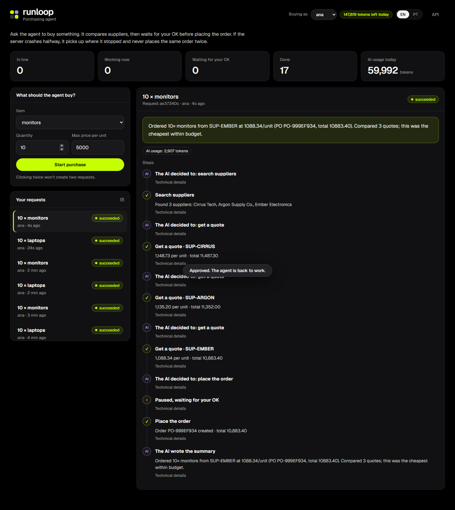
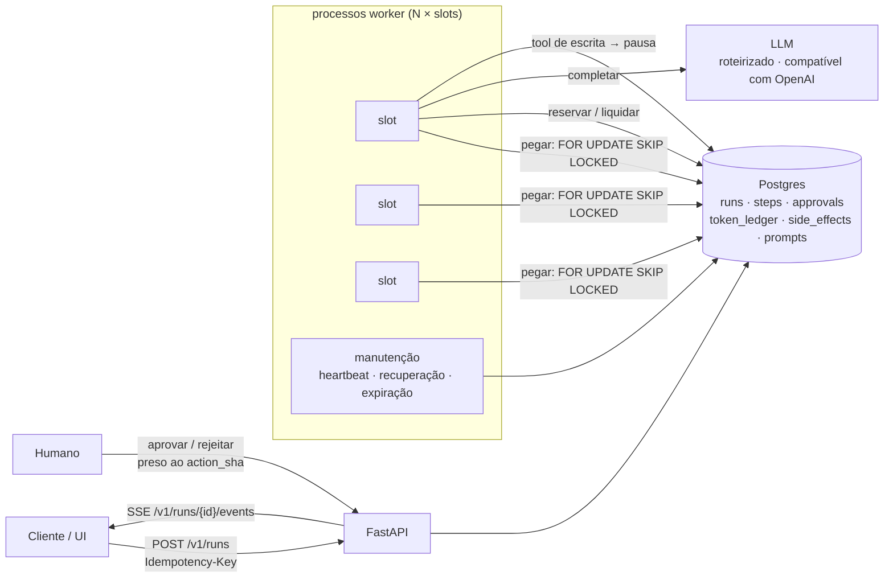
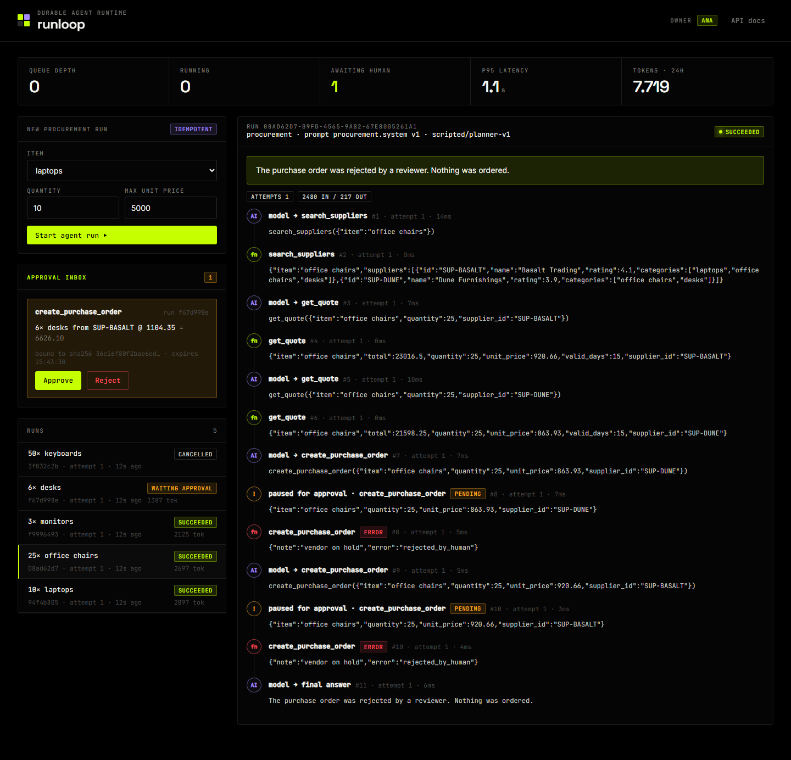
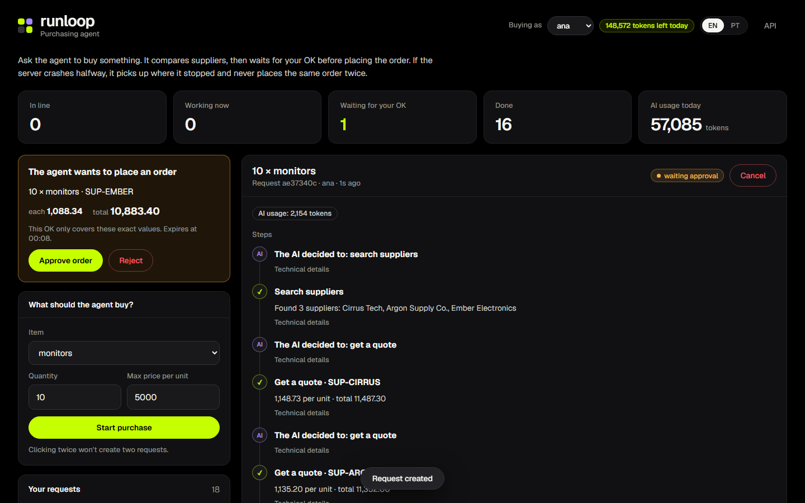

<div align="center">

# runloop · durable-agent-runtime

**Agentes que sobrevivem a quedas, respeitam o orçamento de tokens e pedem a um humano antes de escrever.**
Fila no Postgres (`SKIP LOCKED`) · transcripts retomáveis · efeitos colaterais exatamente uma vez · caixa de aprovações.


[English](README.md) · **Português**



</div>

---

## O problema

Um agente de demo é um `while` num processo só. Um agente em produção é um job
longo que **vai** encontrar um deploy, um OOM kill, um 429 do provedor, um
humano que leva três horas para aprovar e um usuário que clica duas vezes em
"enviar". Este repositório é o runtime que torna tudo isso rotina.

> Roda totalmente offline: o modelo padrão é um planner determinístico, então
> todo teste, demo e teste de caos é reproduzível sem chave de API. Aponte
> `LLM_PROVIDER=openai` para qualquer endpoint compatível com OpenAI
> (OpenRouter, vLLM, Ollama) para usar um modelo real; a chave vem do seu
> ambiente, nunca do repositório.

## Garantias, e como são testadas

| Garantia | Mecanismo | Prova |
|---|---|---|
| Nenhuma execução é pega duas vezes | `UPDATE … FROM (SELECT … FOR UPDATE SKIP LOCKED)` | 8 threads × 40 execuções, cada uma pega exatamente uma vez |
| Worker morto não perde trabalho | heartbeats + `recover_stale` + retomada a partir do transcript salvo | `test_crash_and_recovery…`, **`scripts/chaos.py` mata um processo worker com SIGKILL** |
| Retentativa nunca duplica efeito | `once(run_id:call_id)` sob advisory lock | teste de caos: pedidos de compra == execuções |
| Execuções envenenadas param | `RUN_MAX_ATTEMPTS` → `dead` | `test_stale_runs_are_requeued_then_dead` |
| Clique duplo cria uma execução só | `Idempotency-Key` + hash da requisição (mesma chave, outro corpo → 409) | `test_idempotent_post` |
| Orçamento não estoura em concorrência | ledger de reserva → liquidação/liberação com lock de linha | 10 threads × 300 tok contra 1 000 → exatamente 3 passam |
| O humano aprova *exatamente* o que roda | `action_sha` sobre tool + argumentos canônicos; consumo único; expiração | `test_approval_is_bound_to_exact_arguments` |
| Esperar humano não custa nada | a execução pausa como `waiting_approval` e libera o worker | `test_full_flow_with_approval` |
| Prompts rastreáveis | versionados no banco, um ativo (índice único parcial), execução presa a `(nome, versão)` | `test_run_is_pinned_to_prompt_version` |
| Cancelar funciona no meio | flag cooperativa checada a cada checkpoint | `test_cancel_is_honored_at_next_checkpoint` |
| Worker atrasado não corrompe a execução | toda escrita é `WHERE worker_id = eu AND status = 'running'` | `test_writes_after_losing_ownership_fail` |

## Arquitetura



Estados de uma execução:

```
queued ──pegar──► running ──► succeeded | failed | cancelled
  ▲                 │  └── heartbeat perdido ──► queued (tentativa + 1) … ──► dead
  └── decisão ◄── waiting_approval
```

## Como rodar

```bash
git clone https://github.com/murilo-bassan/durable-agent-runtime.git
cd durable-agent-runtime
pip install -r requirements-dev.txt
docker compose up -d db                         # Postgres 16 em localhost:55432

python -m pytest                                # 29 testes contra Postgres de verdade
python scripts/chaos.py                         # mata um worker no meio e verifica que nada se perde nem duplica

RUNTIME_EMBEDDED_WORKER=true python -m uvicorn runtime.api:app --port 8700
python scripts/demo.py                          # cenários de aprovar / rejeitar / cancelar / sem fornecedor
# → http://localhost:8700 (console) · http://localhost:8700/docs (OpenAPI)
```

No console, o seletor de **dono** define quem cria as novas execuções e mostra o orçamento de tokens restante dele. A interface tem opção PT-BR/EN.

Stack completa com dois processos worker competindo pela fila: `docker compose up --build`.

## API

| Método | Caminho | |
|---|---|---|
| `POST` | `/v1/runs` | enfileira; cabeçalho `Idempotency-Key`; `202` se nova, `200` + `Idempotent-Replayed` na repetição, `409` se a chave for reusada com outro corpo |
| `GET` | `/v1/runs/{id}` · `/steps` · `/events` | estado, linha do tempo dos passos, stream SSE ao vivo |
| `POST` | `/v1/runs/{id}/cancel` | imediato se na fila/aguardando, cooperativo se rodando |
| `GET/POST` | `/v1/approvals` · `/v1/approvals/{id}` | caixa de aprovações e decisão |
| `GET/POST` | `/v1/prompts/{name}` | versões; publicar (texto idêntico não cria versão) |
| `GET` | `/v1/metrics` · `/v1/budget/{owner}` | tamanho da fila, idade do mais antigo, p50/p95, tokens; orçamento restante |

## Saída do teste de caos

```
enqueued 24 runs
worker A killed with 4 runs in flight
succeeded 24/24 · runs that needed a retry: 4 · purchase orders: 24
chaos drill passed ✓
```

(24 execuções enfileiradas, worker A morto com 4 em andamento, 24/24 concluídas, 4 precisaram de retentativa, 24 pedidos de compra: nenhum duplicado.)

## Decisões (em inglês)

- [0001 — O Postgres é a fila](docs/adr/0001-postgres-as-the-queue.md)
- [0002 — Passos pelo menos uma vez, efeitos exatamente uma vez](docs/adr/0002-at-least-once-with-idempotent-effects.md)
- [0003 — Orçamento de tokens com reserva / liquidação / liberação](docs/adr/0003-token-budget-reservations.md)
- [0004 — Aprovações presas aos argumentos exatos](docs/adr/0004-approvals-bound-to-arguments.md)

| Rejeitado duas vezes, o agente se adapta | Console do operador |
|---|---|
|  |  |

---

<sub>Parte de um portfólio de engenharia de IA: veja [ai-engineering-portfolio](https://github.com/murilo-bassan/ai-engineering-portfolio). Combina com o [mcp-tool-gateway](https://github.com/murilo-bassan/mcp-tool-gateway) (governança) e o [llm-routing-eval-lab](https://github.com/murilo-bassan/llm-routing-eval-lab) (avaliação). Licença MIT.</sub>
